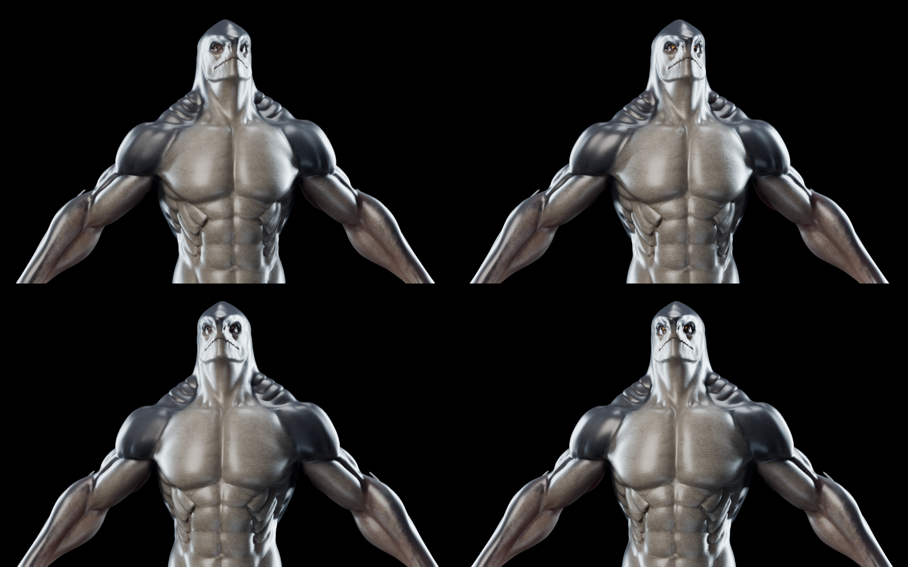
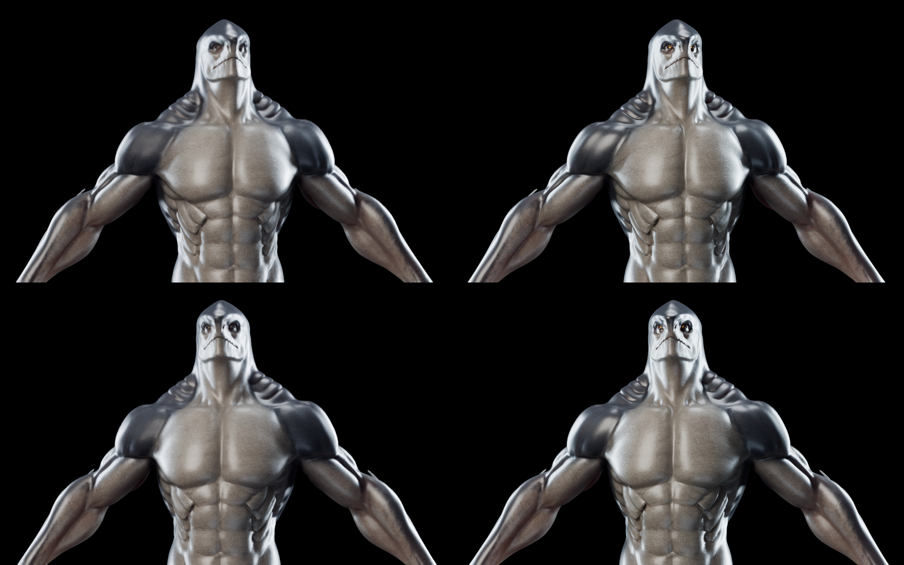
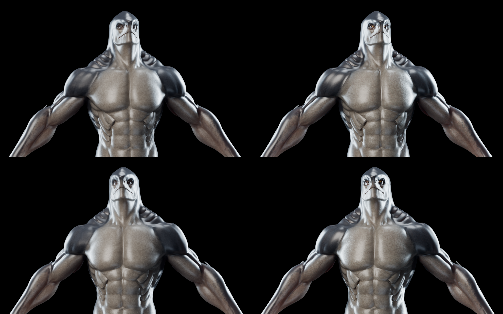

# Makrion: a neural portrait

A shark-man rendered offline in Blender Cycles, then repainted live in the browser by a tiny neural network in WebGPU. No video and no pre-rendered frames: every frame you see is painted by the network, in real time, from where your cursor is.

The technique follows Utsubo's neural renderer ([demo](https://utsubo-neural.utsubo.io/)). The pipeline, network, training and page are original. The Makrion character is by a friend of the project; the original model files are not included (see [What's not here](#whats-not-here)).



*Left: the network. Right: Blender Cycles. Both poses were held out of training.*

## Results

Measured on an RTX 4060 at 1280×800:

| | |
|---|---|
| Frame time in the page | ~19 ms (~52 fps): 3 ms G-buffer, 13 ms network, rest is steadying and display |
| Download | 4.7 MB (about 4 MB compressed) |
| Network size | 60,468 weights + an 8-channel 2048×512 neural texture |
| Quality on 12 never-seen poses | **31.26 dB** PSNR against Cycles (33.19 dB before the eye pass) |

## Run it

```bash
python serve.py
```

- Hero page: http://127.0.0.1:5191/
- Live network against Cycles on never-seen poses: http://127.0.0.1:5191/compare.html

It needs WebGPU, so use a recent Chrome or Edge. Other browsers get one Cycles frame and a note.

## How one frame is made

1. **G-buffer (`src/gbuffer.js`).** Rasterizes the mesh: colour, normal, depth, UV, key light. About 3 ms.
2. **Neural texture.** An 8-channel texture learnt together with the network, sampled through the UVs. With the G-buffer that makes 20 numbers a pixel.
3. **Network (`src/nn.js`).** Eleven conv layers (a small U-Net) in WebGPU compute shaders, shaped by `assets/net.json`. Empty tiles are skipped. About 13 ms.
4. **Steadying and upscale (`src/display.js`).** Sub-pixel jitter with reprojected history, then a sharp upscale to the screen.

## How it was trained

**1. Ground truth in Cycles.** `pipeline/render.py` renders 200 poses of the character (head and eye directions from `make_poses.py`) at 96 samples, about 6 s a frame. 188 are used for training; the last 12 are held out and never trained on.

**2. The same poses through the web rasterizer.** `pipeline/dump.html` runs the page's own G-buffer code over every pose and saves the result, so the network learns from exactly what it will see in the browser. `rig.py` and `deform()` in `src/gbuffer.js` must stay identical; `check_align.py` catches drift.

**3. Base training.** `pipeline/train.py` teaches the network and the neural texture together to turn each G-buffer into its Cycles frame.
- Loss: L1 + image gradients (0.5) + VGG16 perceptual (0.06) + a colour-difference term (2.0), because without it colours drift to grey.
- AdamW with a one-cycle schedule; the neural texture gets a higher learning rate than the layers.
- Random 320 px crops, batch 6, 10,000 steps. About 31 minutes on an RTX 4060 (187 ms a step).
- Result: 33.19 dB on the held-out poses.

**4. Eye pass.** The gold eyes are a few pixels the overall loss barely notices, so they came out dull. A short second run (3,000 steps from the base checkpoint, `--eye 30`) adds extra loss weight on the iris. It trades about 2 dB overall for eyes that actually read as gold: 31.26 dB. An earlier eye pass with a different setting dropped to 28.17 dB and was discarded.

**5. Export.** `train.py` writes the weights (`assets/net.bin`, `net.json`) and the neural texture (`neural_a.png`, `neural_b.png`) that the page loads.

Training progress on held-out poses (network left, Cycles right in each image):

| 2,500 steps | 5,000 steps | 10,000 steps |
|---|---|---|
|  |  |  |

The full logs are in `pipeline/out/train.log`, `train_eye.log` and `train_eye2.log`.

## What I learnt

- **Solid surfaces work; fur doesn't.** A first attempt on a furry snow leopard stayed soft at about 22 dB, needed up to 36 MB of assets and 45 GB of G-buffers. Solid, textured surfaces like Makrion reach near-Cycles quality in about 13,000 steps.
- **The source must be a real 3D model.** A test using AI-generated turntable video (solved into a mesh) stalled at 27.7 dB: AI video isn't 3D-consistent, and the network averages the disagreement into blur.
- **Small bright details need their own loss.** Eyes, highlights and similar few-pixel features need a weighted pass, or the network ignores them.

## Train it yourself

You need a Python venv with `numpy pillow torch torchvision`, plus Chrome or Edge.

**From the released data (no original model needed):**

1. Download `makrion-training-frames.zip` from the [Releases page](../../releases) and unzip it into `pipeline/out/`. It holds a `frames/` folder with the 200 Cycles PNGs (176 MB).
2. Start the server, then save the G-buffers (about 3 GB, a few minutes):
   ```bash
   python serve.py
   ```
   ```bash
   bash pipeline/dump_headless.sh 0 200
   ```
3. Train, then add the eye pass:
   ```bash
   python pipeline/train.py --iters 10000
   ```
   ```bash
   cp pipeline/out/net.pt pipeline/out/net_base.pt
   ```
   ```bash
   python pipeline/train.py --iters 3000 --resume pipeline/out/net_base.pt --eye 30
   ```

To skip training, download `makrion-checkpoints.zip` (the base and final `.pt` files) from the same release.

After training, `pipeline/out/gbuf/` can be deleted; it takes minutes to remake.

**From scratch with your own character:** put a textured model in `shark/`, adjust the file names in `prepare.py` and `render.py`, then run them in Blender 5.2 (for example `blender -b --factory-startup --python-exit-code 1 -P pipeline/render.py -- --start 0 --end 200 --samples 96`), followed by `make_poses.py`, `export_web.py`, the G-buffer dump, `make_compare.py` and training as above.

## Files

| Path | What it is |
|---|---|
| `index.html`, `style.css` | The hero page |
| `compare.html` | Side by side, wipe and face zoom against Cycles |
| `src/main.js` | Pose (cursor, idle life) and the frame loop |
| `src/gbuffer.js`, `src/nn.js`, `src/display.js` | G-buffer, network and display passes in WebGPU |
| `assets/` | Geometry, colour atlas, weights, neural textures, `compare/` frames |
| `pipeline/` | Everything that makes `assets/`: Blender scripts, pose rig, training, export |
| `pipeline/out/` | Poses, rig data, training logs and evaluation images |
| `serve.py` | Local server; also receives G-buffer dumps during training |

## Known limits

- Only cursor head and eye motion is trained. There are no blinks or expressions, because the model has no rig or shape keys.
- The page must stay inside the pose range it was trained on (`make_poses.py` and the cursor limits in `src/main.js`).
- Phones run at half resolution, which the network did not train on, so they look softer.

## What's not here

The original Makrion model and textures (`shark/`) belong to their creator and are not distributed. Everything needed to run the demo and to retrain the network from the released frames is included.

## License

Code: MIT. The Makrion character, and the weights, textures and frames that show it, are shared for study only. See [LICENSE](LICENSE).
